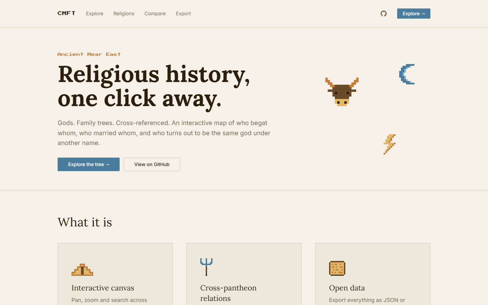
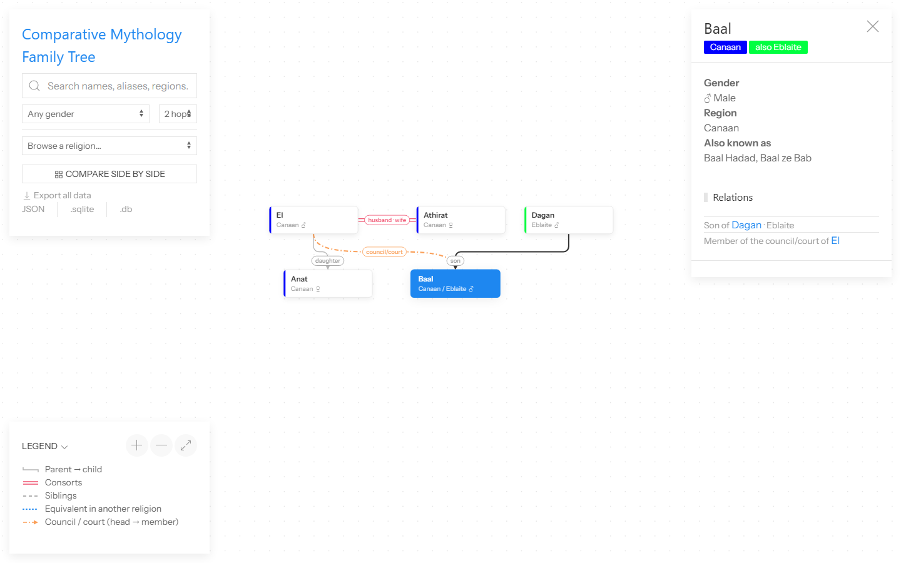
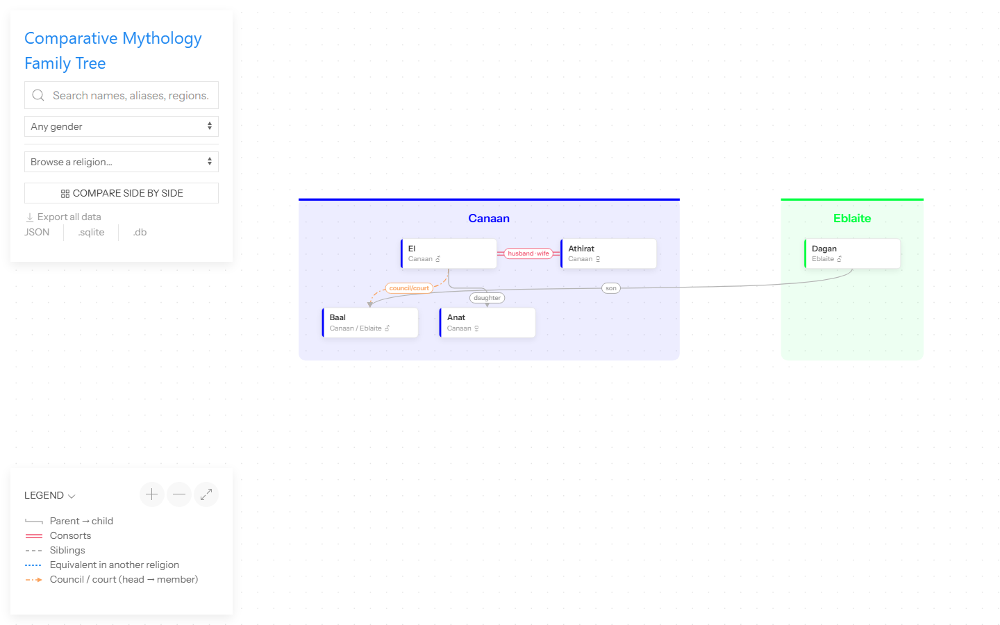
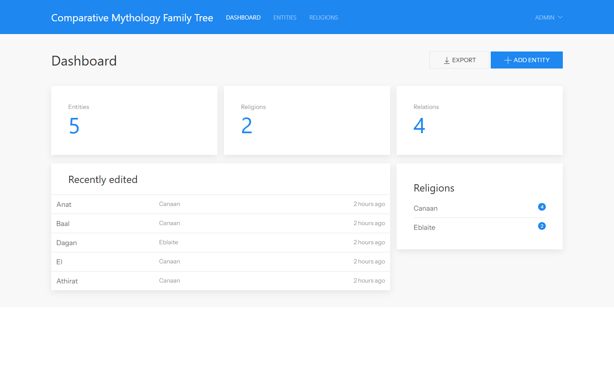

# Comparative Mythology Family Tree

A web app for exploring the family trees of gods, heroes and other mythological figures, and for comparing them across religions and pantheons.

Visitors explore an interactive canvas: they can pan and zoom, search, open any entity's family, or put several religions side by side. Administrators add and edit the data through a separate dashboard.

## Screenshots

| Landing page | Explorer |
| --- | --- |
|  |  |

| Comparing religions side by side | Admin dashboard |
| --- | --- |
|  |  |

## Features

### Landing page (`/` and `/home`)

A short introduction to the project, with links into the explorer and the exports. It is shown to everyone, whether or not they are logged in.

### Public explorer (`/explore`)

- **Canvas family tree.** Generations are laid out as rows, with parents above children and partners side by side. Drag the background to pan, scroll or pinch to zoom, click an entity for its details, and double-click to re-centre the tree on it.
- **Rearrange by dragging.** Drag an entity to move it. Entities stay inside a dashed area: the space the layout needs plus 10%. In a comparison they also stay in their religion's column. The ↻ button (or the R key) puts them back.
- **Element icons.** Entities with an element get a pixel icon on their node: Wisdom (book), Storm (lightning), War (sword), Fertility (leaf), Sea (droplet), Fire (flame), Sun (sun) and Love (heart). Common synonyms match too, e.g. *Thunder*, *Ocean*, *Harvest*, *Agriculture*, *Solar*. Elements without an icon still show in the details panel.
- **Relations.**
  - Parent → child lines are labelled *son*, *daughter* or *child*.
  - Consorts are joined by a double line, siblings by a dashed arc.
  - Equivalents across religions (Zeus ≈ Jupiter) are joined by a dotted arc.
  - Council/court membership is an arrow from the head to the member.

  Each line carries its tradition and note when they are recorded (e.g. *son · Eblaite*). Labels are only drawn where there is room.
- **Search** by name, alias (including non-Latin scripts), element, region or origin, optionally filtered by gender and element.
- **Browse a religion** to see all of its members. Entities that belong to several pantheons appear in each of them.
- **Compare side by side.** Pick 2–4 religions and each one gets its own column. Generations line up across columns, so a parent in one pantheon still sits above a child in another. The link can be shared, e.g. `/compare?religions=eblaite,canaanite`.
  - **"Is like" links.** An entity whose syncretic origin is also on the canvas gets a purple dashed arrow to it, with a pixel "twins" badge (e.g. Jupiter → Zeus). Hover the badge for a description.
- **Depth control.** On an entity's page, choose how many relation hops around it are shown (1–4).
- **Download as PNG.** The image button saves the whole tree as a PNG at 2× resolution, as currently arranged and without the background grid or drag area.
- **Legend** listing every line style, the element icons, and (in comparisons) the "is like" link.

### Export

Anyone can download the whole dataset: visitors from the explorer's left panel, admins from the dashboard's **Export** button.

| Format | URL | Contents |
| --- | --- | --- |
| JSON | `/export/json` | `religions`, `entities` and `relations`; entities and relations each list their `sources` |
| SQLite | `/export/sqlite` or `/export/db` | The same data as a standalone database with foreign keys. It has the tables `religions`, `entities`, `entity_religions`, `relations`, `sources` and `meta`. Both URLs return the same file; only the extension differs. |

- **Identifiers.** Religions and entities are identified by their slug, and relations refer to entities by slug. A relation is identified by its `kind`, `from` and `to`. An entity's `syncretic_origin` is the slug of the entity it was syncretised from or most resembles. The app's own database ids are not exported. The integer keys in the SQLite file only link its tables together and are numbered fresh for each export.
- **Role words.** Each relation includes `from_role` and `to_role`: the relation read from each end, in that entity's gendered words (e.g. `"Father of"` / `"Daughter of"`, `"Husband of"` / `"Wife of"`). They are computed from the entities' genders at export time. If you change a gender in an exported file, change these too; `gender` is the source of truth.
- **Sources.** Each source has a `kind` (`link` or `file`), a `url` for links, and a `ref` for the line, verse or page cited. File sources give the file's path inside the download (`sources/…`) and its `original_name`. When any uploaded source files exist, the download becomes a zip (`…-json.zip`, `…-sqlite.zip`) holding the JSON or SQLite file plus a `sources/` folder; otherwise it is the plain file.
- **Versioning.** The file's `format_version` is currently 3 (adds sources, `element` and `syncretic_origin`).
- **Privacy.** Exports never include user accounts or other app internals.

### Admin dashboard (`/admin`)

- **Religions** with an optional colour, used for node stripes, comparison columns and labels.
- **Entities**, each with:
  - name, gender, element, region/area, origin and aliases (one per line);
  - a primary religion, plus any other religions it also belongs to (e.g. *Baal*: Canaanite, also Eblaite);
  - an optional **syncretic origin / most like**: another entity it was syncretised from or most resembles (e.g. Roman *Jupiter* → Greek *Zeus*). It can't point at itself, and is cleared if that entity is deleted.
- **Filters** on the entity list by search text, religion, gender and element. The element field suggests elements already in use, to keep spellings consistent.
- **Relations:** *parent/child*, *consort*, *sibling*, *equivalent* and *member of council/court*. Each relation can have an optional tradition and a note. Duplicates, self-links and contradictory links are rejected.
- **Drag-to-reorder** the entity list. This order is also the starting left-to-right order of siblings on the canvas.
- **Switch sides (⇄).** While logged in as an admin, each consort or sibling pair on the canvas has a ⇄ button that swaps which one is drawn on the left.
- **Sources.** Cite where the data comes from, on entities and on relations:
  - An entity's sources are listed on its edit page, with a form to add a **link** (an `http(s)` URL) or an uploaded **file**, plus an optional **reference** for the line, verse or page (e.g. *KTU 1.2 IV 11–12*).
  - Each relation on that page links to its own sources page ("2 sources" / "Add sources").
  - Sources can be edited (a link's URL and reference; a file's reference, or a replacement upload) and removed. Removing or replacing a file deletes the stored file.
  - Uploads are documents or images (pdf, txt, md, doc, docx, odt, rtf, epub, png, jpg, webp, gif) of up to 20 MB, or less if PHP's `upload_max_filesize` / `post_max_size` are lower; the form shows the limit that applies. Files are kept on the private disk and only admins can download them.

There is no public registration. Only admins can log in, and only they can change data.

## Tech stack

| Area | Choice |
| --- | --- |
| Backend | Laravel 13, PHP 8.5 |
| Database | SQLite |
| Cache | [CitronDB](https://github.com/AurielSolaris/CitronDB), via a custom PHP driver (see below) |
| Views | Blade templates, styled with [UIkit](https://getuikit.com) |
| Frontend scripts | TypeScript, Alpine.js, axios |
| Tree rendering | HTML `<canvas>`, custom layout and renderer (`resources/js/explorer`) |
| Package manager / bundler | Bun, Vite |
| Tests | PHPUnit |

## Getting started

### Requirements

- PHP 8.5 and Composer. The quickest way to install both on Windows, macOS or Linux is [php.new](https://php.new).
- [Bun](https://bun.sh).

### Install

```bash
composer setup
```

This installs the PHP and frontend dependencies, creates `.env`, generates the app key, runs the migrations and builds the frontend assets. If it reports that the SQLite database is missing, create an empty `database/database.sqlite` and run it again.

### Create an administrator

```bash
php artisan app:create-admin
```

The command asks for an email address, a name and a password (at least 8 characters). If the email already belongs to a user, it offers to make that user an admin instead.

### Run

```bash
composer run dev
```

Or use the scripts in the project root, which also set up anything missing on first run (dependencies, `.env`, app key, SQLite database, migrations) and check that PHP has the extensions the app needs (`openssl`, `pdo_sqlite`, `mbstring`, `fileinfo`, `curl`):

| Script | What it does |
| --- | --- |
| `./run-dev.sh` / `run-dev.bat` | Starts the dev servers, like `composer run dev`. Extra arguments go to `php artisan dev`. |
| `./run-build.sh` / `run-build.bat` | Installs the frontend dependencies from the lockfile, type-checks, and builds the assets into `public/build`. |

| URL | What it is |
| --- | --- |
| http://localhost:8000 | The app: the explorer, plus `/login` and `/admin` |
| http://localhost:5173 | Vite's asset server. It only serves scripts and styles; open the app on port 8000. |

A good order for entering data: religions first, then entities, then relations and sources (from each entity's edit page).

## Project layout

```
app/
  Cache/            CitronStore and CitronLock: the Laravel cache driver
  Citron/           CitronDB: a pure-PHP implementation of the CitronDB file format
  Enums/            Gender, RelationKind, RelationRole, SourceKind
  Http/Controllers/ Explorer and graph JSON (public), Admin/* (dashboard)
  Models/           Religion, Entity, EntityRelation, Source
  Support/          EntityGraph (the node/edge JSON the canvas draws), DatasetExport
resources/
  js/explorer/      Canvas tree: layout.ts, renderer.ts, elements.ts (pixel icons), explorer.ts (Alpine)
  js/admin/         Entity picker, sortable rows, confirmation dialogs
  views/            explorer.blade.php, admin/* (including admin/sources), auth/login
public/
  favicon.svg       The logo: a pixel-art SVG on a 16-unit grid (the master for every icon)
  favicon.ico, apple-touch-icon.png, icon-192.png, icon-512.png, site.webmanifest
                    The logo rasterized for browsers, home screens and link previews
docker/             Apache, PHP and entrypoint config for the container image
```

### Data model

- **Religion:** name, slug and optional colour.
- **Entity:**
  - name, slug, gender, element (free text), region, origin, aliases and manual position;
  - a primary religion (`religion_id`) plus additional religions (the `entity_religion` table);
  - an optional `syncretic_origin_id`: a foreign key to another entity, set to null if that entity is deleted.
- **EntityRelation:** two entities, a kind, an optional tradition and an optional note.
  - *parent* and *council* are directional: `entity_id` is the parent, or the head of the council.
  - *consort*, *sibling* and *equivalent* are symmetric and stored once, with the lower id first. `sides_swapped` records the admin's chosen left/right order.
- **Source:** a citation on an entity or a relation (polymorphic `sourceable`, stored as `entity` / `entity_relation`). It has a `kind` (`file` or `link`), a `url` or a stored `path` (with the uploaded `original_name`), and a `ref` for the line or verse. Files live on the private `local` disk under `sources/` and are deleted with their source. Deleting an entity also deletes its relations' sources.

### Graph endpoints (used by the canvas)

| Endpoint | Returns |
| --- | --- |
| `GET /graph/entities/{slug}?depth=1-4` | An entity and its neighbourhood |
| `GET /graph/religions/{slug}` | A religion's members, plus their equivalents in other religions |
| `GET /graph/compare?religions=a,b` | 2–4 religions as side-by-side columns |
| `GET /search/suggestions?q=…&gender=…&element=…` | Search suggestions |
| `GET /export/{json,sqlite,db}` | Download the whole dataset |

## The CitronDB cache driver

CitronDB is a single-file key-value database written in Perl, with official bindings for C and Python only. This app talks to it through a pure-PHP implementation of the file format in `app/Citron/CitronDB.php`, so it needs neither Perl, a compiled library nor PHP's FFI extension.

- **Compatible with the official tools.** It uses the same file format (version 2), the same `<db>.lock` file locking, and the same atomic writes (write to a temporary file, flush it to disk, rename it over the database). The Perl, C and Python tools can therefore use the same file at the same time.
- **Laravel cache store.** The `citron` store (`app/Cache/CitronStore.php`) supports expiry, tags, atomic `add`/`increment`, and locks. The cache file is `storage/framework/cache/cache.citron`.
- **Windows notes.**
  - The interop with Perl was checked against native Strawberry Perl. Git Bash's bundled MSYS Perl locks files in a way that no native implementation (C, Python or this driver) can see, so don't use it on a shared database.
  - Replacing the file is briefly retried, in case a virus scanner is holding it open.

## Tests

```bash
php artisan test        # PHP feature and unit tests
bun run typecheck       # TypeScript
vendor/bin/pint         # code style
```

## Docker

```bash
php artisan key:generate --show          # copy the key it prints
APP_KEY=base64:... docker compose up --build
docker compose exec app php artisan app:create-admin
```

The app is then available at http://localhost:8080.

- **Image.** A multi-stage build: Bun builds the assets, and the app runs on PHP 8.5 with Apache.
- **Persistent data.** The SQLite database, uploaded source files and the CitronDB cache live on named volumes.
- **Uploads.** The image's PHP settings allow uploads of up to 24 MB, enough for the 20 MB source limit.
- **Startup.** Migrations run automatically when the container starts.
- **HTTPS.** If the container runs behind a reverse proxy that handles HTTPS, configure Laravel's trusted proxies.

## License

Copyright © 2026 Debaditya Malakar. Released under the [GNU General Public License v3.0](LICENSE).
